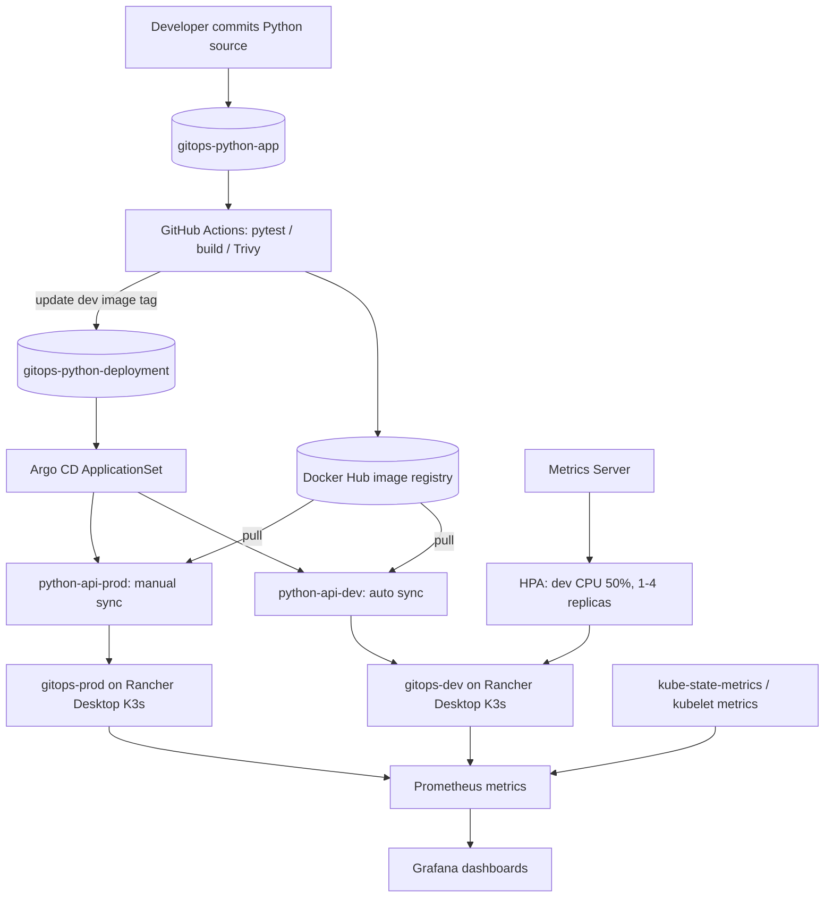

# Python GitOps Delivery Platform — Helm, Argo CD & Kubernetes

> **Portfolio project · Local K3s lab · CI/CD, release promotion, autoscaling and observability**

A hands-on deployment platform for a containerized Python Flask API, built to demonstrate how GitHub Actions, Docker Hub, Helm, Argo CD ApplicationSet, Kubernetes HPA, Prometheus, and Grafana work together. The project deliberately separates application source from desired deployment state.

**Repositories**

- [Application source — gitops-python-app](https://github.com/mrattdevops/gitops-python-app)
- [GitOps configuration — gitops-python-deployment](https://github.com/mrattdevops/gitops-python-deployment)

> **Scope:** This project runs on a single-node Rancher Desktop K3s lab. The `gitops-prod` namespace represents a production-like release workflow, not an actual isolated production environment.

## Architecture



See [architecture & decisions](docs/architecture.md) for a larger diagram and explanation.

## Technology stack

| Layer | Tools | Purpose |
|---|---|---|
| Application | Python, Flask, Gunicorn, pytest | API, probes, automated tests |
| Container delivery | Docker Buildx, Docker Hub | Versioned multi-platform images |
| CI | GitHub Actions, Trivy, yq, Helm | Test, build, scan and update dev GitOps values |
| Configuration | Helm | One reusable chart, separate dev/prod values |
| CD | Argo CD ApplicationSet | Generate environment applications, reconcile desired state |
| Runtime | Rancher Desktop, K3s | Local Kubernetes cluster |
| Autoscaling | Metrics Server, HPA | CPU-driven dev replicas (1–4) |
| Observability | kube-prometheus-stack, ServiceMonitor, Grafana | Platform and Flask metrics |

## Delivered functionality

- Separate Git repositories for application code and Kubernetes manifests; CI writes a new dev image tag to Git, while Argo CD deploys it.
- Git SHA image tagging and Docker Hub image publishing; dev syncs automatically, prod requires a deliberate Git promotion and manual Argo CD sync.
- Helm chart used for two namespaces: `gitops-dev` (one baseline replica) and `gitops-prod` (two baseline replicas).
- GitOps rollback exercise: simulated an invalid image tag, observed failed rollout, restored a known-good tag and recovered to `2/2` production-like pods.
- Dev HPA configured for 50% CPU target, 1–4 replicas; load test observed scaling to four and returning to one.
- Prometheus/Grafana infrastructure dashboards and Flask `/metrics` instrumentation with an application ServiceMonitor.

## Evidence from the lab

| Exercise | Observed outcome |
|---|---|
| Python tests | 4 initial tests passed; metrics instrumentation added later |
| Argo CD dev/prod | `Synced / Healthy` for both Applications |
| Prod rollback | Kubernetes rollout succeeded; two pods `1/1 Running` |
| HPA exercise | Replica count increased `1 → 4` then returned `4 → 1` |
| Metrics Server | APIService `Available=True` |
| Platform monitoring | kube-prometheus-stack installed and Grafana dashboards configured |

**Screenshots:** Add real evidence to `evidence/` following [the capture checklist](docs/evidence-checklist.md). Do not substitute synthetic screenshots.

## Repository map

**Application repository**

```text
gitops-python-app/
├── .github/workflows/ci.yml
├── app.py
├── metrics.py
├── tests/
├── requirements.txt
└── Dockerfile
```

**GitOps repository**

```text
gitops-python-deployment/
├── argocd/
│   ├── applicationset.yaml
│   └── monitoring-application.yaml
├── charts/python-api/
│   ├── Chart.yaml
│   ├── values.yaml
│   └── templates/
├── environments/
│   ├── dev/values.yaml
│   └── prod/values.yaml
└── monitoring/
    ├── values.yaml
    └── dashboards/
```

## Getting started (existing Rancher Desktop lab)

```bash
kubectl config use-context rancher-desktop
kubectl get applications -n argocd
kubectl get deployment -n gitops-dev
kubectl get deployment -n gitops-prod
kubectl get hpa -n gitops-dev
```

Dev API test (port-forward occupies terminal):

```bash
kubectl -n gitops-dev port-forward svc/python-api-dev 8080:80
# in a second terminal:
curl http://localhost:8080/health/ready
curl http://localhost:8080/api/info
curl http://localhost:8080/metrics
```

This README is not a one-command installation promise. Provision K3s / Argo CD / registry credentials and GitHub secrets before bootstrapping a new cluster. See [operations runbook](docs/runbook.md).

## Release model

1. Push source to app repository `main`.
2. CI runs pytest, builds an image, performs the Trivy scan, and publishes a Docker Hub tag based on the commit SHA.
3. CI updates **only** `environments/dev/values.yaml` in the GitOps repo.
4. Argo CD automatically reconciles `python-api-dev`.
5. After validation, create a PR copying the approved dev image tag into `environments/prod/values.yaml`.
6. Merge the PR; review the Argo CD diff and manually sync `python-api-prod`.
7. Roll back by restoring a known-good image in Git and syncing prod.

See [release and rollback guide](docs/release-process.md).

## Operational visibility

- HPA: `kubectl get hpa python-api-dev -n gitops-dev`
- Prometheus: infrastructure and application metrics with a Flask ServiceMonitor.
- Grafana: request throughput, error rate, P95 latency, pod CPU/memory, restarts and HPA replica counts.

## Known limitations and next improvements

- This is a single-node local lab; dev/prod namespaces do not provide failure-domain or security isolation.
- Git SHA tags are traceable, but pinning workloads by image digest would strengthen artifact immutability.
- HTTP load-test endpoint must be removed/disabled before exposing the service beyond a trusted lab.
- Trivy scan should be run **before** image publication if publish-on-pass is a requirement, and multi-platform scan coverage should be reviewed.
- Prometheus/Grafana were initially installed through manual Helm. `argocd/monitoring-application.yaml` is a **migration candidate**, not evidence that Argo CD already owns that release. Preserve credentials and review resource ownership before syncing.
- Add GitHub branch protection, least-privilege automation credentials, secrets management, Kubernetes NetworkPolicies, and externalized alerting for future production-style work.

## Documentation

- [Architecture and design decisions](docs/architecture.md)
- [Operations and troubleshooting](docs/runbook.md)
- [Release promotion and rollback](docs/release-process.md)
- [Project case study](docs/case-study.md)
- [Screenshot / proof checklist](docs/evidence-checklist.md)

## Author / reviewer notes

Created as an individual DevOps engineering lab to learn and demonstrate deployment automation, GitOps release controls, autoscaling, troubleshooting and observability. Technical feedback on architecture, least privilege, Helm design, release safety and monitoring ownership is welcome.
