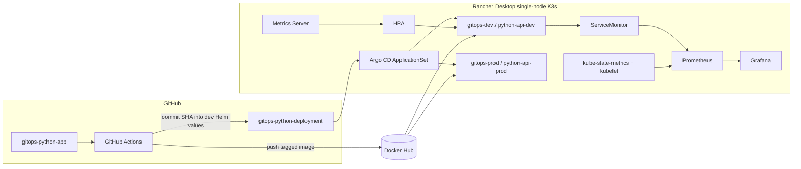

# Architecture & design decisions

## High-level system

## Separation of concerns

- **App repository:** source, tests, Dockerfile and CI build logic.
- **Deployment repository:** Helm, environment-specific values, ApplicationSet and monitoring configuration.
- **Registry:** images; K3s pulls them when a new tag is synchronized.
- **Argo CD:** reconciles application desired state; it does not build images.

## Environment policy

| Concern | Dev | Prod-like lab |
|---|---|---|
| Namespace | `gitops-dev` | `gitops-prod` |
| Helm release/Application | `python-api-dev` | `python-api-prod` |
| Initial replicas | 1 | 2 |
| Synchronization | Automatic | Manual |
| Updates | CI changes dev tag | Human-reviewed image promotion |
| HPA | Enabled, CPU 50%, 1–4 | Disabled in lab |

## Design rationale

1. **Separate repos:** image delivery and desired state remain independent and auditable.
2. **Helm values:** avoid duplicated Deployment YAML across environments.
3. **ApplicationSet:** generated Applications share predictable structure while allowing environment-specific sync policies.
4. **Promotion of the same image tag:** avoid rebuilding the artifact for prod.
5. **HPA:** CPU requests enable utilization-based scaling; Metrics Server supplies usage observations.
6. **Prometheus/Grafana:** platform telemetry and request-level application metrics support validation.

## Explicit constraints

This architecture intentionally models a release workflow on one local machine; it does not claim multi-cluster availability, disaster recovery, resilient persistent storage, or production security controls. Monitoring Helm-to-Argo CD migration is not complete unless independently verified.
